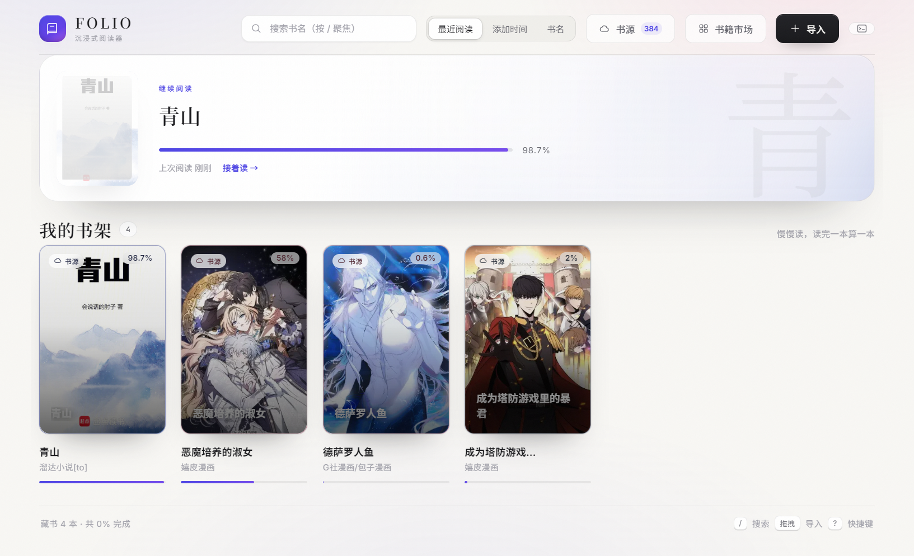

# folio-assets

[Folio](https://github.com/flulwh/folio) 的文档截图资源仓库。

图片与主仓库分离，是为了让 `folio` 的 clone 不必为了十几张 README 截图多拉 22 MB。

## 使用方式

Markdown 直接引用：

```
https://raw.githubusercontent.com/flulwh/folio-assets/main/docs/<文件名>.png
```

例如：

```markdown

```

GitHub 渲染 README 时会通过 camo 缓存外链图片，所以浏览者实际访问的是 GitHub CDN，不受源站速度影响。

## 目录

- `docs/` —— 主仓库 `docs/` 目录迁移过来的截图（46 张）
